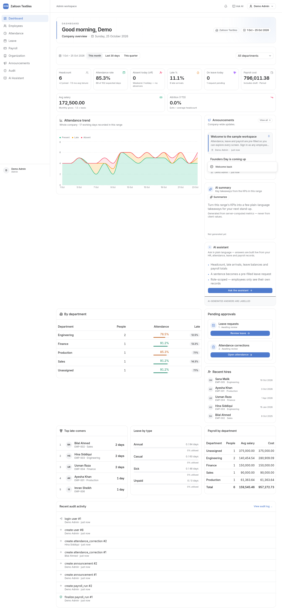
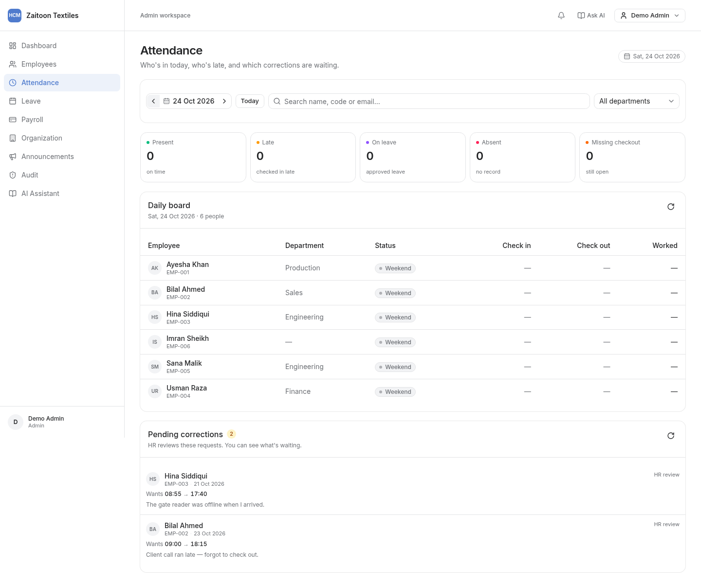
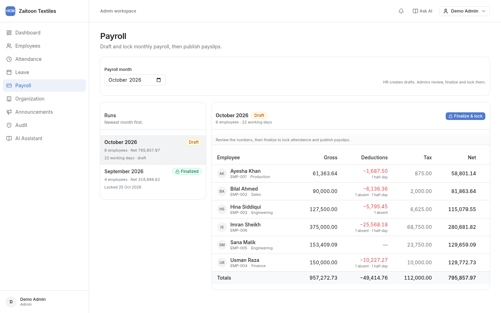
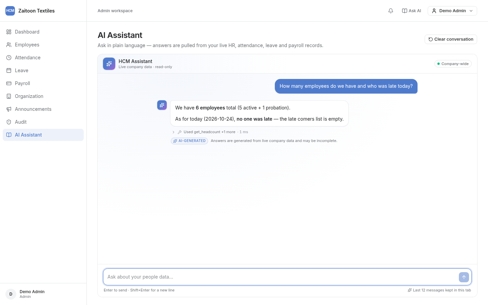
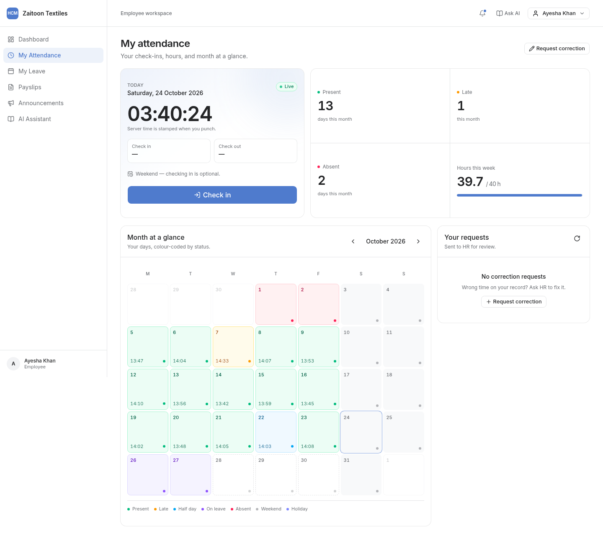
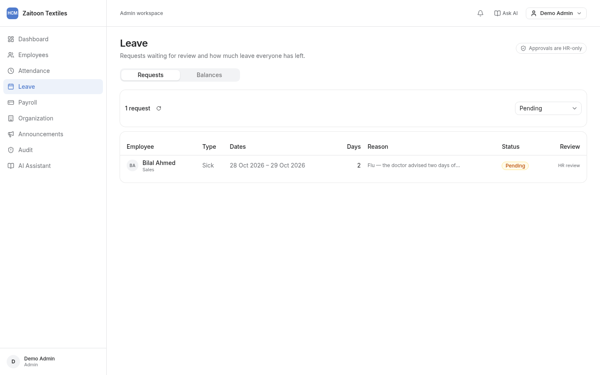
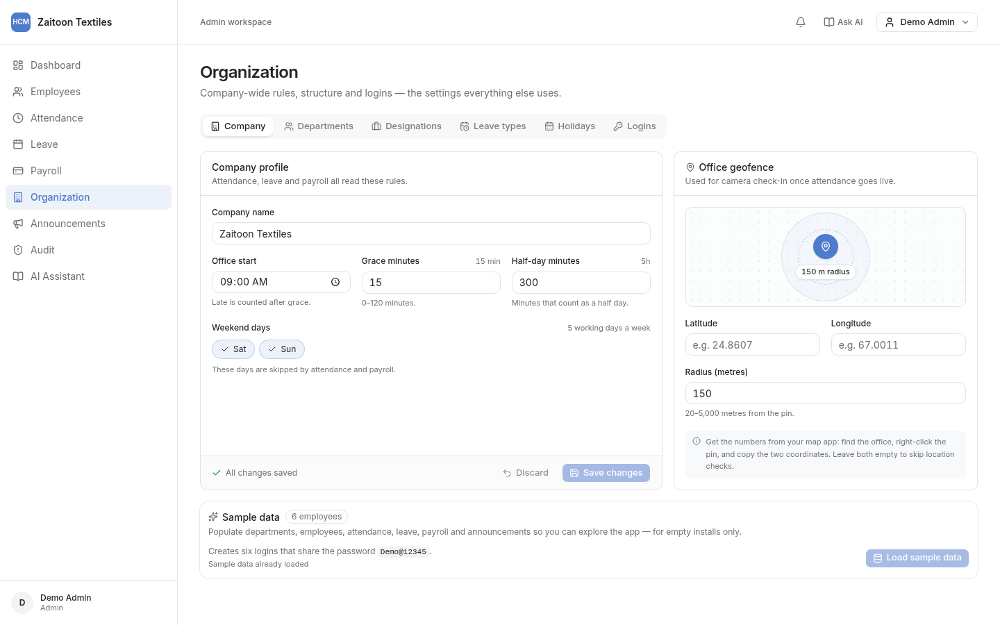
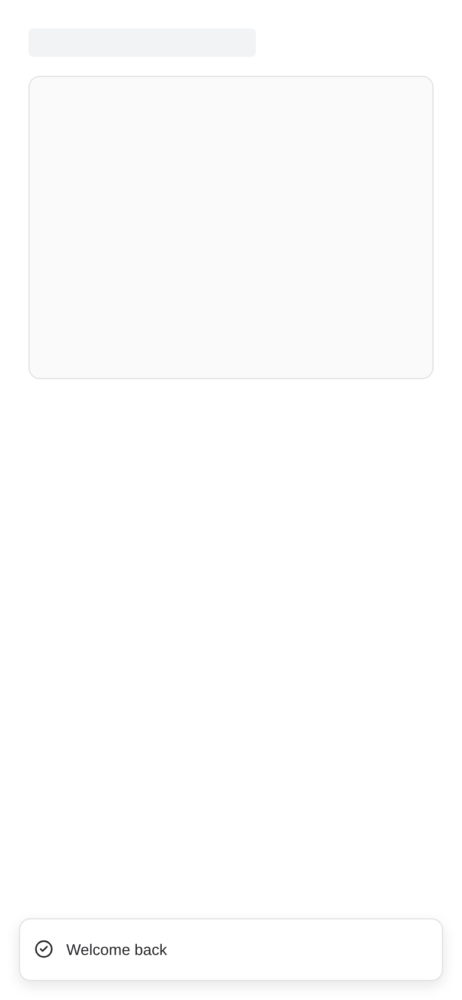

<p align="center">
  
</p>

<h1 align="center">HCM Lite</h1>

<p align="center">
  <strong>AI-assisted human capital management</strong> — Admin, HR and Employee roles; nine modules;
  an assistant that answers <em>only</em> from your own database via tool calling.
</p>

<p align="center">
  <a href="https://hcm-lite.thetrillioniar.me"></a>
  
  
  
  
</p>

<p align="center">
  <a href="https://hcm-lite.thetrillioniar.me"><b>Live demo</b></a> ·
  <a href="docs/DEMO.md">Demo script</a> ·
  <a href="#architecture">Architecture</a> ·
  <a href="#sample-data-exploring-or-judging">Sample logins</a> ·
  <a href="#judging-checklist">Judging checklist</a>
</p>

<p align="center">
  
</p>

**Live demo:** https://hcm-lite.thetrillioniar.me — a hosted install you can judge cold. On an empty
database it opens at the first-run setup wizard; to fill every screen in one click, sign in as Admin →
**Organization → Company → Load sample data**. Reset it to a blank install with
`bash scripts/reset-deployed-db.sh`. Judge path: [docs/DEMO.md](docs/DEMO.md).

Built for the Saylani Hackathon (24 Oct 2026).

---

## Screenshots

| | |
|---|---|
| **Attendance board (HR/Admin)** — daily status per employee, corrections inbox<br/> | **Payroll run** — proration, deductions, tax slabs, finalize & lock<br/> |
| **AI assistant** — answers built from tool results, labelled AI-generated<br/> | **My attendance (Employee)** — server-stamped punches, month calendar, 40 h week<br/> |
| **Leave** — approval inbox with working-day counts and balances<br/> | **Organization** — company settings, departments, designations, leave types, holidays, logins<br/> |

<p align="center">
  
  <br/><sub>Responsive down to 390 px — no horizontal overflow on any page.</sub>
</p>

---

## The problem

A real HR team needs one place for people, attendance, leave, payroll and reports — where each role
sees exactly what it should. Off-the-shelf HRMS products are heavy, and demo data hides the part that
matters: whether the numbers are computed correctly from the records the user just created.

HCM Lite starts **empty**. Admin sets up the company, HR registers employees (registration creates
their login), employees check in and request leave, HR approves and runs payroll, Admin finalizes and
the month locks. Every dashboard number and every AI answer is derived from those rows — nothing is
seeded, nothing is hardcoded.

## Roles

| Role | Creates | Reads | Deliberately cannot |
|---|---|---|---|
| **Admin** | Company settings, departments, designations, leave types, holidays, HR logins, announcements | Everything, company-wide dashboards, audit log | Register employees, approve leave, edit drafts |
| **HR** | Employees + their logins, attendance corrections approval, leave approvals, payroll drafts, CSV imports/exports, announcements | Company-wide dashboards, all employee records | Change company settings, finalize payroll, see the audit log, edit a finalized month |
| **Employee** | Own check-in/out, own leave requests, own correction requests, own phone/address | Only their own attendance, leave, payslips, profile | See anyone else's salary or records; every route re-checks this server-side |

## Modules

1. **Auth & access** — bcrypt passwords, signed JWT cookie (`hcm_session`), forced password change on
   first sign-in for HR-created accounts, role + data-scope guards on every API route.
2. **Org setup** — company name, office hours + grace, weekend days, leave types with quotas, holidays,
   departments, designations, HR logins.
3. **Employees** — registration (creates the login), directory with server-side search/filter/sort/page,
   Employee 360 (profile, attendance, leave, payslips, account), own contact edit, CSV dry-run import + export.
4. **Attendance** — web check-in/check-out stamped by the server, one record per employee per day,
   status rules, employee month calendar, HR daily board, correction requests with approval.
5. **Leave** — apply, cancel, working-day math, quota + overlap validation, approval inbox with comments,
   balances per type.
6. **Payroll lite** — salary structure, monthly draft with proration, deductions, tax slabs, Admin
   finalization that locks the month, payslip PDF, notification on payslip.
7. **Dashboards** — role-scoped KPIs and trends, all computed in SQL from the live tables.
8. **AI assistant** — chat with tool calling, dashboard summary, smart leave (sentence → validated
   pre-filled form), policy Q&A, rate limit, timeout fallback, `ai_logs`, and an "AI-generated" label.
9. **Comms & audit** — announcements, in-app notifications, and an append-only audit log with
   before/after snapshots of every create/update/approve/finalize.

## Business rules (single source of truth: `lib/services/*`)

**Attendance** — office start 09:00, grace 15 min; a check-in after **09:15** is `late`. Worked time
under **5 h** is `half_day`. A day with no record and no approved leave is `absent`; a check-in without
a check-out is `missing_checkout`. Weekends (Sat–Sun) and holidays are never counted as working days.

**Leave** — entitlements: annual 14, sick 8, casual 10, unpaid unlimited. Only working days consume
balance. Overlapping requests or requests that exceed the remaining balance are rejected with `422`.

**Payroll** — `gross = 1.5 × basic` (HRA 40 %, medical 10 % of basic), `perDay = gross ÷ working days`.
Absent days and unpaid leave are deducted in full, half days at 0.5. Joiners and leavers are prorated by
eligible working days. Tax is computed on `gross × 12`:

| Annual gross | Tax |
|---|---|
| 0 – 600,000 | 0 |
| 600,001 – 1,200,000 | 5 % of the excess over 600,000 |
| 1,200,001 – 2,400,000 | 30,000 + 15 % of the excess over 1,200,000 |
| 2,400,001 – 3,600,000 | 210,000 + 25 % of the excess over 2,400,000 |
| above 3,600,000 | 510,000 + 35 % of the excess over 3,600,000 |

Monthly tax is the annual figure ÷ 12. Floating point is rounded only at the last step, so a payslip
always reproduces from its inputs. Admin finalization writes an audit entry and freezes the month:
no more attendance corrections, no payroll edits, no re-finalization.

## Stack

- **Next.js 16** App Router (React 19, Turbopack, Cache Components), TypeScript, Tailwind v4
- **shadcn/ui** on **Base UI** primitives (the `base-nova` style — `render={...}` instead of `asChild`)
- **SQLite** via the built-in `node:sqlite` `DatabaseSync` driver — no native build step, WAL mode,
  schema applied idempotently from `lib/schema.sql`
- **jose** (HS256 JWT in an httpOnly cookie) + **bcryptjs**
- **zod** for every request body
- **recharts** for dashboard charts, **pdf-lib** for payslips, **date-fns** for dates, **sonner** for toasts
- **OpenRouter** (OpenAI-compatible) with a free model — the API key never leaves the server

## Architecture

```
app/
  api/…                  route handlers; auth + role + scope enforced per route
  (app)/…                authenticated pages (server components gate on getSessionUser())
lib/
  db.ts  schema.sql      SQLite singleton, WAL, helpers (queryAll/queryOne/run)
  auth.ts  guards.ts     JWT session, requireUser/requireRole/scopeEmployeeId, ApiError
  validation.ts          zod schemas
  services/              ALL business logic + SQL (attendance, leave, payroll, employees, org,
                         users, analytics, comms, ai-tools, audit) — never duplicated in the UI
  dates.ts               working-day math (weekend + holiday aware)
components/…             UI per area (employees, org, attendance, leave, payroll, …) + ui/ primitives
scripts/                 API smoke tests, Playwright checks, deploy helpers
docs/                    frozen contracts per milestone (schema, endpoints, permissions, rules)
```

Rule of thumb used throughout: **routes own permissions, services own rules, pages own presentation.**
Employees readonly paths (`/api/attendance/me`, `/api/leave/requests`, `/api/payroll/payslips`) are scoped
by `scopeEmployeeId()`, so an employee id in a query string can never widen scope.

## Run locally

Requires **Node 22+** (for `node:sqlite`).

```bash
npm install
cp .env.example .env
npm run dev               # http://localhost:3000
```

For a production build:

```bash
npm run lint
npm run build
npm start
```

The SQLite database is created automatically on first access.

### How to create the first Admin

There is nothing to log in to on a fresh install — the app creates the first Admin for you:

1. Run the steps above and open http://localhost:3000 (on the hosted app, just open the URL).
2. With an empty database the app redirects straight to **`/setup`** — no login exists yet.
3. **Step 1 — Organization & working hours:** company name and **Day starts at** (the 15-minute
   grace period is applied automatically; weekends and the half-day threshold are tuned later in
   Organization) → **Continue**.
4. **Step 2 — Administrator:** full name, **work email** and **password** → **Create company**.
5. The company row and the first Admin account are created in one transaction, and you are signed
   in as Admin.

Env bypass (useful for a hosted first-run, CI or a demo where you do not want the wizard): set
`ADMIN_EMAIL` and `ADMIN_PASSWORD` in `.env` (optionally `COMPANY_NAME`) and open the app — the
company and Admin are created automatically. If either admin variable is missing, the wizard is
shown instead.

Then, as Admin, add departments, designations, leave types and holidays, and create an HR login
(Organization → Logins). Sign in as HR to register employees — each registration returns a one-time
temporary password that the employee must change on first sign-in.

To start over: stop the dev server and delete `dev.db` (and its `-wal`/`-shm` files), or run
`bash scripts/reset-deployed-db.sh` against the deployed instance — it wipes the live DB and the
app opens at `/setup` again.

### Setting the AI key

The AI assistant (chat, smart leave, dashboard **Summarize**) reads its key **server-side only** —
it is never shipped to the browser and never appears in a client bundle. In `.env`:

```bash
OPENAI_API_KEY=sk-or-...           # OPENROUTER_API_KEY is accepted as a fallback
OPENAI_BASE_URL=https://openrouter.ai/api/v1
OPENAI_MODEL=openrouter/free       # must support tool calling
```

Restart the server after editing `.env`. The app **runs fine without a key**: auth, org, employees,
attendance, leave, payroll, dashboards, audit and payslips all work, and the assistant simply shows
its fallback state (e.g. a rules-based summary) instead of an AI answer. See the
[Environment](#environment) table below for every variable.

### Sample data (exploring or judging)

A fresh install is empty by design. To populate a realistic dataset in one click, sign in as
**Admin → Organization → Company → Load sample data**. It creates 4 departments, 5 designations,
6 employees (logins `firstname.lastname@hcm.demo` / `Demo@12345`), 30 weekdays of attendance with a realistic mix of
present / late / half-day / missing-checkout / absent, three leave requests, a finalized previous
month plus a draft current month of payroll, announcements and pending corrections. The endpoint is
Admin-only (`POST /api/demo/seed`) and refuses to run once employees exist.

### Environment

| Variable | Purpose |
|---|---|
| `DATABASE_URL` | SQLite path, e.g. `file:./dev.db` (also accepts an absolute path) |
| `AUTH_SECRET` | HS256 secret for session JWTs; generate with `openssl rand -base64 32` |
| `OPENAI_API_KEY` | OpenRouter (or any OpenAI-compatible) key — server-side only |
| `OPENAI_BASE_URL` | Defaults to `https://openrouter.ai/api/v1` |
| `OPENAI_MODEL` | Defaults to `openrouter/free` (verified to support tool calling) |
| `APP_URL` | Public app URL sent as the AI provider's `HTTP-Referer` (defaults to `http://localhost:3000`) |
| `FACE_MATCH_THRESHOLD` | Cosine similarity required for a camera check-in to match the enrolled face (defaults to `0.62`) |
| `COMPANY_NAME`, `ADMIN_NAME`, `ADMIN_EMAIL`, `ADMIN_PASSWORD` | Optional first-run bypass; when email and password are set, the company and Admin are created automatically |

`OPENROUTER_API_KEY` is also accepted as a fallback for `OPENAI_API_KEY`. The AI assistant is
optional: the HR, attendance, leave, payroll, dashboard and audit features work without an AI key.

## AI assistant

`POST /api/ai/chat` sends the conversation plus a tool schema to the model. The model picks a tool, the
backend executes it **with the caller's scope**, feeds the result back, and the model answers. Tools:
`get_headcount`, `get_attendance_summary`, `get_late_comers`, `get_leave_summary`,
`get_my_leave_balance`, `get_payroll_summary`, `search_employees`, `get_policy`.

Guardrails: 20 requests per user per hour, 15 s timeout with a friendly fallback bubble, every call
logged to `ai_logs`, all answers labelled **AI-generated**, and an employee asking about someone else's
salary is refused before the model is even called. The key is read from the server environment only.

## Deployment

Hosted on `tests2` behind a Cloudflare named tunnel (`hcm-lite`), with a persistent SQLite file at
`/home/ubuntu/hcm-lite/data/hcm.db`.

```bash
./scripts/deploy-tests2.sh    # local build check → push → remote git reset + npm ci + build + restart → health check
./scripts/reset-deployed-db.sh  # wipe the live DB → back to the first-run setup wizard
./scripts/deployed-check.mjs    # Playwright: setup → login → dashboard → every nav page, 1440 + 375
```

The remote host needs Node 22 (`/opt/node22`) because of `node:sqlite`; the tunnel config lives at
`~/.cloudflared/hcm-lite.yml`.

The face models (~10 MB) are not committed: `postinstall` copies them from `@vladmandic/human` into
`public/models/`, so `npm ci` on the server prepares them and `/models/...` is served from the build.

## Verification

- `scripts/api-smoke.mjs` — auth, setup, password change, logout
- `scripts/api-smoke-m2.mjs` — org CRUD, users, employees, search/paging, CSV import/export, RBAC, audit rows
- `scripts/api-smoke-m3m5.mjs` — attendance status rules, leave working-day math + 422s, payroll numbers
  (proration, deductions, tax slabs), finalize lock, payslip PDF magic bytes
- `scripts/api-smoke-m6.mjs` — dashboard KPIs, filters and role scoping
- `scripts/api-smoke-m7a.mjs` — AI tools, salary refusal, rate limiting, `ai_logs`
- `scripts/api-smoke-m8.mjs` — announcements, notifications, audit viewer permissions
- `scripts/api-smoke-demo-seed.mjs` — sample-data loader (API + UI, 1440/375)
- `scripts/e2e-full.mjs` — the whole journey from an empty database through the UI (18 checks)
- `scripts/deployed-check.mjs` — live URL walkthrough with Playwright (desktop + 375 px screenshots)
- `scripts/acceptance-security.mjs`, `scripts/acceptance-security-fixes.mjs`, `scripts/acceptance-api.mjs`,
  `scripts/acceptance-ui.mjs` — acceptance passes for security, API and UI
- `scripts/api-smoke-face.mjs` — face-attendance **backend** only (see
  [Scope](#scope--done--not-done): not part of the demo)

Each smoke script boots `next start` on its own port against a throwaway SQLite file, so they can run
without touching `dev.db`.

## Scope — done / not done

### Done — works end to end from an empty database

- [x] The nine **Modules** above, in one deployment: auth & access, org setup, employees,
      attendance, leave, payroll + payslip PDF, dashboards, AI assistant, comms & audit.
- [x] Three-role RBAC re-checked server-side on every API route, plus an append-only audit log
      with before/after snapshots.
- [x] First-run setup wizard at `/setup`, plus the `ADMIN_EMAIL` / `ADMIN_PASSWORD` env bypass.
- [x] Sample-data loader (Admin → Organization → Company → *Load sample data*) and
      `scripts/reset-deployed-db.sh` for a clean demo.
- [x] Hosted deployment, screenshots, `docs/DEMO.md` (5-minute script) and this README.

### Not done — the brief's bonus rows, honestly

- [ ] **Camera + geofence face attendance** — built but **not shipped and not verified**; do not
      count it. The backend is smoke-tested (`scripts/api-smoke-face.mjs` reports `SMOKE: ALL PASS`
      in `.agent-logs/face-smoke-*.log` — challenge, cosine match, geofence, audit rows, no
      embedding leaked) and a frontend exists (`app/(app)/face-check-in`, `components/face/*`), but
      the frontend is **uncommitted as of this writing** and neither the page nor the camera flow
      has been verified in a browser or on the live URL.
- [ ] **Attrition risk score** — not implemented.
- [ ] **Absence anomaly flags** — not implemented (absence is computed per day; nothing flags
      unusual patterns).
- [ ] **Late-penalty rule (3 lates = 0.5 day)** — not implemented; lateness is reported on the
      board and in KPIs, never penalised.
- [ ] **Roman Urdu understanding** — not implemented (assistant and smart leave expect English).
- [ ] **Dark mode** — not implemented (no theme provider, no `dark` variant in `app/globals.css`).
- [ ] **PWA** — partial only: `app/manifest.ts` (name, icons, `display: standalone`) is served, but
      there is **no service worker**, no offline support and no install testing, so the PWA bonus is
      not claimed.

### Not shipped (out of scope by decision)

email/SMS delivery, multi-company tenancy, recruitment, performance, documents, org chart, mobile
app, and editing a finalized payroll run.

## Judging checklist

Maps the brief's scoring rows to where each one is evidenced — no capability is claimed that is not
listed above.

| Row | Pts | Evidence |
|---|---|---|
| **Core HR flows** | 25 | The nine modules; `scripts/e2e-full.mjs` (empty DB → UI journey), `scripts/api-smoke-m2/m3m5`, `scripts/acceptance-*.mjs`; demo steps 1–8 and 11–12 in `docs/DEMO.md` |
| **Data & analytics** | 20 | Dashboards module — every KPI computed in SQL by `lib/services/analytics.ts`; `scripts/api-smoke-m6.mjs`; dashboard screenshots; demo steps 9–11 |
| **AI features** | 15 | AI assistant module (8 tools, salary refusal, rate limit, `ai_logs`), smart leave and dashboard **Summarize**; `scripts/api-smoke-m7a.mjs`, `scripts/api-smoke-ai-summary.mjs`; demo steps 7, 9, 10, 13 |
| **Code quality** | 15 | [Architecture](#architecture) — routes own permissions, services own rules, pages own presentation; zod on every request body; idempotent schema. Check with `npm run lint`, `npx tsc --noEmit`, `npm run build` |
| **UI/UX** | 10 | [Screenshots](#screenshots), responsive to 390 px, shadcn/ui on Base UI; `scripts/deployed-check.mjs` and `scripts/acceptance-ui.mjs` capture desktop + mobile passes |
| **Security & RBAC** | 10 | [Roles](#roles) table (the "deliberately cannot" column), bcrypt + httpOnly JWT cookie, per-route guards, `scopeEmployeeId()`; `scripts/api-smoke-m2/m7a/m8`, `scripts/acceptance-security.mjs` |
| **Demo & docs** | 5 | `docs/DEMO.md` (300 s script with cheat sheet and breakage plan), this README (stack, run, first Admin, AI key, done/not done), live URL + repo links |

**Bonus (+10):** none of the six bonus rows is claimed — see
[Scope — done / not done](#scope--done--not-done) for what exists and what does not.

## License

This project was created for the Saylani Hackathon. Add the repository's chosen license here before
publishing it for reuse.
